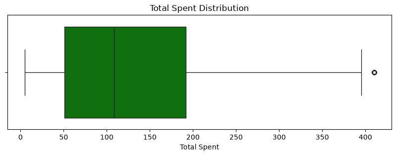
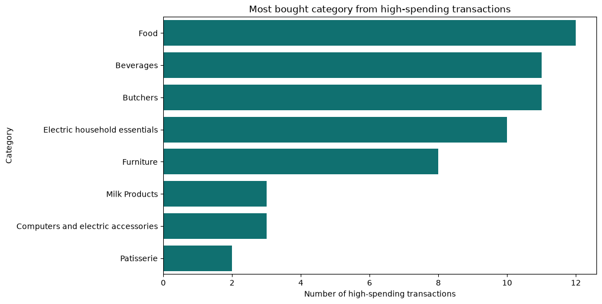
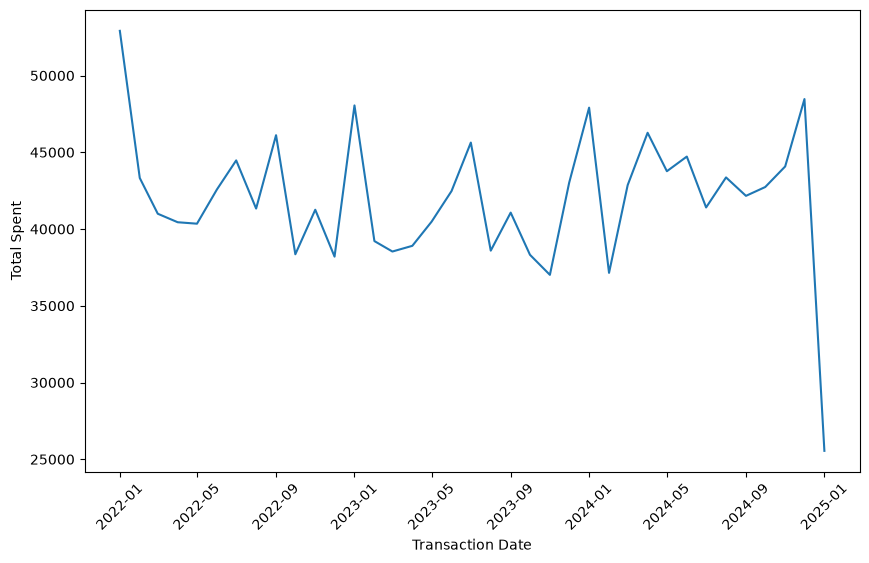

# Retail Store Sales: Exploratory Data Analysis

An exploratory analysis of retail-store transaction data, focused on spending behavior, high-value purchases, and sales patterns over time.

## Project goals

- Clean and prepare the transaction data for analysis.
- Describe the distribution of transaction spending and identify outliers.
- Explore the categories represented in high-spending transactions.
- Track monthly sales totals over the available time period.

## Tools used

- Python
- Pandas and NumPy
- Matplotlib and Seaborn

## Repository contents

| File | Description |
| --- | --- |
| `Data_Cleaning.ipynb` | Data-cleaning process and preparation steps. |
| `Data_Analysis.ipynb` | Descriptive analysis and visualizations. |
| `retail_store_sales.csv` | Original transaction dataset. |
| `cleaned_data.pkl` | Cleaned dataset used by the analysis notebook. |
| `visualizations/` | PNG versions of the key charts. |

## Key findings

- The average transaction spend is **$129.65**, while the median is **$108.50**, indicating a right-skewed spending distribution.
- Using the 1.5 x IQR rule, transactions above **$403.50** are high-spending outliers; there are **60** such transactions.
- Food appears most often among high-spending transactions (**12 transactions**), followed by Beverages and Butchers (**11 each**).
- Monthly sales fluctuate rather than following a consistent upward trend. January 2025 is incomplete and should not be compared directly with full months.

## Visualizations

### Total spending distribution



### Categories of high-spending transactions



### Monthly sales trend



## How to run

1. Clone this repository.
2. Install the required Python libraries:

   ```bash
   pip install pandas numpy matplotlib seaborn
   ```

3. Open and run `Data_Cleaning.ipynb` before `Data_Analysis.ipynb`.
